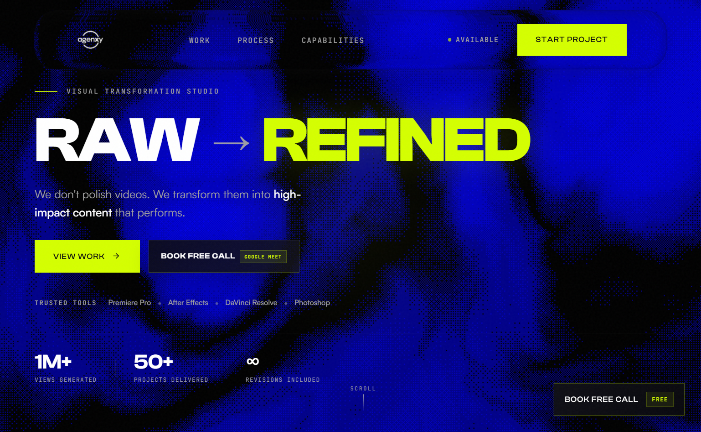

# CREATIVE CURRENT

<p align="center">
  
</p>

<p align="center">
  <strong>Visual Transformation Studio</strong><br />
  High-impact video editing, creator branding, and retention-driven digital content.
</p>

<p align="center">
  
  
  
  
  
</p>

---

## ⚡ What is Creative Current?

**Creative Current** is a cutting-edge creative agency website built for a modern, creator-first visual transformation studio.

Rather than looking like an interchangeable agency template or a corporate software page, Creative Current is built with an editorial neo-brutalist aesthetic, cinematic typography, and interactive WebGL shaders. It is purposefully engineered to communicate technical depth, aggressive attention-retention pacing, and high production value.

> *"We don't just 'edit' videos, we fix the pacing and punch up the visuals so people actually stop scrolling."*

---

## 🎬 Core Services & Capabilities

Creative Current specializes in taking raw footage and converting it into high-converting, viral-ready assets:

- **Precision Video Editing:** Premiere Pro & DaVinci Resolve workflows calibrated for retention and rhythm.
- **Motion Graphics & VFX:** Custom After Effects animations and kinetic typography that boost perceived production quality.
- **Short-Form Content:** Hook-driven, 9:16 vertical video production for Instagram Reels, TikTok, and YouTube Shorts.
- **AI Enhancement:** Noise reduction, Topaz AI resolution upscaling, and intelligent compression.
- **Sound Design & Engineering:** Layered SFX and audio mastering that command viewer attention.
- **CTR-Optimized Thumbnails:** High-contrast graphic assets designed to capture impressions and drive click-through rates.

---

## 🚀 Key Website Features

1. **Interactive WebGL Dither Shader:**
   - Full-screen custom Three.js shader background responding dynamically to cursor position, velocity, and wave frequencies.
2. **Liquid Glassmorphism Navigation:**
   - Floating glass header featuring chromatic dispersion, backdrop blur, real-time status pill, and mobile drawer navigation.
3. **Cinematic Hero Experience:**
   - Real-time mouse spotlighting, typography animations, interactive booking integration, and key trust markers.
4. **Narrative & Problem/Solution Showcase:**
   - Identifies creator pain points (retention drops, lost editing hours, dull visuals) and presents the studio's transformational workflow.
5. **Interactive Portfolio & Work Grid:**
   - Direct showcases of client transformations, music visuals, and an interactive macOS-styled window connecting to the full Google Drive portfolio.
6. **Social Proof & Client Testimonial:**
   - Verified client testimonial card featuring an interactive voice note audio player and animated metric counters (4.9 Rating, 24h Turnaround, 100% Satisfaction).
7. **High-Intent Contact & Booking Flow:**
   - Responsive CTA bar with mouse-tracking glow, Cal.com modal scheduling for discovery calls, direct email triggers, and alternative contact channels.

---

## 📬 Contact & Inquiries

Get in touch with **Creative Current** through any of our primary or alternative channels:

| Channel | Detail | Action |
| :--- | :--- | :--- |
| **Primary Email** | `hello@creativecurrent.com` | [Send Email](mailto:hello@creativecurrent.com) |
| **Alternative Email** | `contact@creativecurrent.com` | [Send Email](mailto:contact@creativecurrent.com) |
| **Phone / WhatsApp** | `+1 (555) 019-2834` | [Call / Text](tel:+15550192834) |
| **Discovery Call** | Google Meet / Cal.com | Integrated into website booking buttons |
| **Instagram** | `@creativecurrent` | [View Instagram](https://www.instagram.com/creativecurrent) |
| **X (Twitter)** | `@creativecurrent` | [Follow on X](https://x.com/creativecurrent) |
| **YouTube** | `@creativecurrent` | [Watch on YouTube](https://www.youtube.com/@creativecurrent) |
| **Telegram** | `@creativecurrent` | [Chat on Telegram](https://t.me/creativecurrent) |

---

## 🛠️ Tech Stack

- **Core Framework:** [React 19](https://react.dev/)
- **Bundler & Build Tool:** [Vite 7](https://vite.dev/)
- **Styling:** [Tailwind CSS 4](https://tailwindcss.com/) & Vanilla CSS Modules
- **Graphics & 3D:** [Three.js](https://threejs.org/), [@react-three/fiber](https://r3f.docs.pmnd.rs/), [@react-three/postprocessing](https://github.com/pmndrs/react-postprocessing)
- **Scheduling Embed:** [@calcom/embed-react](https://cal.com/)
- **Typography:** Clash Display, Satoshi ([Fontshare](https://www.fontshare.com/)), and JetBrains Mono
- **Iconography:** [Remix Icon](https://remixicon.com/)

---

## 📁 Project Structure

```bash
Creative-Current/
├── public/
│   ├── github-preview.png     # Repository preview banner
│   └── vite.svg               # Vite asset
├── src/
│   ├── assets/
│   │   ├── logo.svg           # Creative Current vector branding logo
│   │   ├── JAMES PFP.jpeg     # Verified client avatar
│   │   └── James Testimonial.mp3 # Client voice note audio asset
│   ├── components/
│   │   ├── Button/            # Reusable magnetic / stylized button
│   │   ├── CalBookingButton/  # Cal.com discovery call modal trigger
│   │   ├── Capabilities/      # Capabilities grid & curved text marquee
│   │   ├── CTA/               # Interactive mouse-tracking contact bar
│   │   ├── CurvedLoop.jsx     # SVG curved text animation component
│   │   ├── Dither.jsx         # WebGL / Three.js interactive background
│   │   ├── Footer/            # Primary & alternative contact channels + socials
│   │   ├── GlassSurface.jsx   # Chromatic glassmorphism container
│   │   ├── Header/            # Floating glass nav & mobile menu drawer
│   │   ├── Hero/              # Spotlight hero banner with metrics
│   │   ├── Narrative/         # Problem & solution storytelling layout
│   │   ├── Testimonial/       # Voice note audio player & animated metrics
│   │   └── Work/              # Selected projects & Drive portfolio window
│   ├── lib/
│   │   └── utils.js           # Utility helpers (clsx, tailwind-merge)
│   ├── App.css
│   ├── App.jsx                # Application root with Dither background
│   ├── index.css              # Global styles, typography & color variables
│   └── main.jsx               # React entry point
├── brand_identity.md          # Creative Current brand positioning document
├── index.html                 # Main HTML entry with SEO metadata & SVG favicon
├── package.json               # Project manifest & scripts
├── vite.config.js             # Vite configuration
└── README.md                  # Project documentation
```

---

## 💻 Getting Started Locally

### Prerequisites

Ensure you have [Node.js](https://nodejs.org/) (v18 or higher recommended) and `npm` installed on your machine.

### Installation

1. **Clone the repository:**
   ```bash
   git clone https://github.com/your-username/Creative-Current.git
   cd Creative-Current
   ```

2. **Install dependencies:**
   ```bash
   npm install
   ```

3. **Start the development server:**
   ```bash
   npm run dev
   ```
   Open your browser and navigate to `http://localhost:5173`.

4. **Build for production:**
   ```bash
   npm run build
   ```

5. **Preview the production build:**
   ```bash
   npm run preview
   ```

---

## 📄 License

This project is open-source under the [MIT License](LICENSE).
© 2026 Creative Current. All rights reserved.
